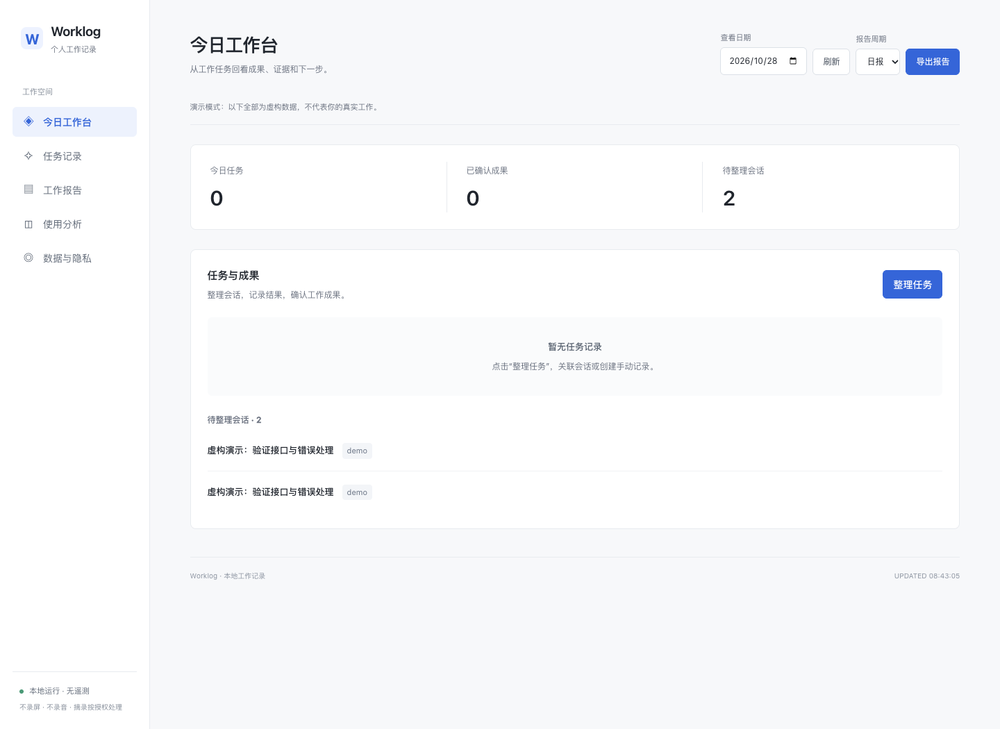

# AI Worklog · 本地 AI 开发工作台

## 当前迭代：从会话统计到工作任务

首页现在先展示人工审阅的任务、工作结果和待整理会话；模型/Token 统计移到“使用分析”。任务可关联同日多个 Pi/Codex 会话，也可不选会话，手动记录线下工作。AI 生成的总结仍是草稿，只有在任务卡片中填写并保存的人工审阅内容才作为报告中的工作结果。

```bash
# 自动发现本机 Pi/Codex 会话目录；只在本机读取，不自动调用模型
python3 app.py start --db data/personal.sqlite3

# 可选：显式增加一个 Git 仓库，只读取当日提交的摘要和改动行数
python3 app.py start --db data/personal.sqlite3 --git-repo /absolute/path/to/repository

# 如需手动生成 AI 草稿，再加 --enable-llm；摘录另需 --allow-excerpts
python3 app.py start --db data/personal.sqlite3 --enable-llm
```

打开命令输出的完整本地链接。创建任务后，在“人工审阅与修订”填写状态、结果、经验、验证和下一步；Git 提交由你选择关联，提交记录本身不代表测试或验收通过。界面右上角可切换日报、周报和月报并下载；命令行也支持：

```bash
python3 app.py report --db data/personal.sqlite3 --period week --date 2026-10-29
python3 app.py report --db data/personal.sqlite3 --period month --date 2026-10-29 --out data/october.md
```

`start` 仅提供本地自动发现和轮询；需要只读取指定来源时，仍可使用下方的 `serve --watch --pi-dir ...`。Git 导入是显式的，不扫描整个磁盘。详细边界见 [本轮产品迭代](docs/product-iteration.md)。

`0.4.0`（当前迭代）：增加任务人工审阅、显式 Git 提交关联、周/月报和一键启动；`0.3.0` 的命令行增量回顾继续保留。



## 不开网页：命令行增量回顾

```bash
# 在仓库目录操作。首次明确从现在开始；此步不读取日志、不调用模型。
# --allow-excerpts 会保存此来源范围内的脱敏摘录授权，后续回顾无需重复授权。
./bin/worklog-review --start-now --allow-excerpts

# 以后每次结束对话后执行：直接在终端按工作条目输出总结。
./bin/worklog-review

# 不调用模型、不标记已回顾，只预览本次将使用的材料。
./bin/worklog-review --preview

# 查看上一次成功回顾，也可导出到一个不存在的文件。
./bin/worklog-review --last
./bin/worklog-review --last --out data/last-review.md
```

- 便携入口默认只读 Pi 日志，使用独立的 `data/review.sqlite3`。命令不要求网页服务，也不需要常驻采集：Pi 自己保存日志，下次回顾再读取。
- 每次最多4批，每批最多24条证据、12个会话；按已验证条目流式输出，不直接打印未经脱敏/引用校验的模型原始 token。积压留到下次同一命令，`--batch-limit 1` 可减少单次调用，最大12批。
- 成功输出并完成可选文件导出后，才原子标记所覆盖事件。失败/取消不推进记录点；已验证结果缓存可复用。迟到日志、相同时间戳的新事件仍按事件ID识别，不只比较时间戳。
- 首次需要历史回顾，可把 `--start-now` 换成 `--since '2026-10-29T09:00:00+08:00'`。没有自动判断“退出对话”的钩子；边界由首次起点和后续成功回顾明确建立。
- `--metadata-only` 撤销当前来源的摘录授权。模型只能概括受限材料，不等于自动识别或验收全部业务任务；只在 IDE 中手动修改、未写入 AI 会话的活动不在覆盖范围。
- 来源发生读取缺口时默认停止，不调用模型/标记已回顾。先用 `--preview` 检查；只有明确接受不完整结果才使用 `--allow-partial`。默认最多读取每个来源500个JSONL文件，非文件增量游标。
- 默认使用 Pi 现有模型，也可传 `--summary-provider` / `--summary-model`；依赖第三方扩展的 provider 暂不适配。命令行只限制每次批数，不继承网页服务的每日10任务额度，不是费用封顶。

需要 Codex 时，在**首次建立起点和每次回顾**都加 `--codex-dir "$HOME/.codex/sessions"`；来源组合有独立记录点，不会静默合并授权。更详细的边界、输出和清理说明见 [增量回顾](docs/incremental-review.md)。

## 网页任务总结（0.2.0 起）

- **手动结束并总结**：在“任务记录”页关联最多12个会话，或不选会话记录线下工作；关联会话后可预览脱敏材料，按需生成阶段总结或结束任务并总结。
- **自动阶段总结**：显式开启后，为本次启动之后的新活动建立会话任务；自然结束的回复空闲10分钟后总结。未完成工具调用不会直接触发，阶段总结永不自动标记任务完成。
- **复用现有 Pi 模型**：默认使用 Pi 的 defaultProvider/defaultModel，也可由启动参数指定。本机已用 `openai-codex / gpt-6.1-sol` 做合成材料真实调用验证。
- **受限脱敏摘录**：只选用户需求、助手文本结论及工具状态；不发送思维链、工具参数、原始输出、图片或系统提示词。长消息、代码块、常见凭据和路径会省略或脱敏。
- **可追溯草稿**：总结包含概述、做过的工作、结果线索、阻塞、下一步建议及证据ID，并进入Markdown日报。引用合法不证明结论真实，仍需人工审阅。
- **控制调用**：单工作进程、同一材料去重、显式失败重试、每日默认最多10个总结任务；旧排队任务也受当日执行额度限制。

原有活动时间线、模型/缓存统计、异常记录、按日期导出和匿名元数据模式继续可用。

## 启动：手动 + 自动总结

Python 3.9+；元数据功能仅用标准库。LLM功能还需要已安装、已登录的 Pi，以及所选模型的可用额度。**本程序仍不是自启动或后台常驻软件。**

```bash
git clone https://github.com/CCdddbb/ai-worklog.git
cd ai-worklog
python3 app.py serve --db data/personal.sqlite3 \
  --watch --pi-dir "$HOME/.pi/agent/sessions" \
  --enable-llm --allow-excerpts --auto-summarize \
  --idle-minutes 10 --daily-summary-limit 10 \
  --summary-provider openai-codex --summary-model gpt-6.1-sol
```

打开终端打印的完整 `http://127.0.0.1:.../#token=...` 链接；不要分享。令牌仅留在当前页面内存，刷新整个页面后需重新打开完整链接。`Ctrl+C` 停止HTTP、采集和总结进程。

- 不希望自动调用：去掉 `--auto-summarize`，仍可手动结束并总结。
- 不允许对话摘录出设备：去掉 `--allow-excerpts`，只发送元数据及任务名称，但总结信息会少很多。
- 不调用模型：去掉所有总结相关选项，运行普通 `serve` 或 `serve --watch`。
- 单独Codex日志：可增加 `--codex-dir "$HOME/.codex/sessions"`。Pi已有CodeBuddy使用记录，不重复导入其桥接副本。
- 不指定provider/model时使用Pi默认选择。总结进程禁用扩展，**依赖第三方扩展的provider暂不自动适配**；不会静默切换到其他模型。

默认只扫描各来源最新20个JSONL文件，可用 `--max-files` 调整（最大500）。页面和日报披露覆盖与跳过情况，不保证所有历史都已扫描。

## 如何使用任务总结

1. 到“任务总结”页，确认显示的模型、摘录授权和自动模式。
2. 输入任务名称，勾选关联会话，指定从当天几点开始记录，创建任务。
3. 点“预览当前材料”检查即将使用的脱敏内容。
4. 点“阶段总结”，或“结束并总结”；后者代表用户结束记录，不是模型确认业务已验收。
5. 等待“AI草稿已生成”，可查看本次冻结的证据快照，并导出含总结的日报。

自动模式按已授权范围执行，不等待逐次预览确认。默认仅处理启动后的新活动，不把历史所有对话自动发给模型。旧的、已经排队且配置与授权相同的任务可以恢复执行；更换模型、来源目录或摘录授权时，旧任务会被阻止并要求重新触发。

同一批活动不会持续重复总结；活动继续后可生成新阶段。失败不会无限自动重试，需手动重试。同日达到额度的旧排队任务会等待后续额度；这是任务数限制，不是费用封顶，Pi本身的重试也可能产生额外调用与费用。

**网页中的任务按所选日期和起始时间限定范围。** 手动可关联同日多个对话；自动默认按会话分组，不盲目合并不同业务。跨日应分别建立阶段任务，尚未实现多日任务自动归并。

## 隐私与执行隔离

- 未启用LLM时，默认只保存匿名元数据。`--titles` 是独立的短标题选项，不等于允许模型调用。
- `--enable-llm --allow-excerpts` 授权选定的脱敏摘录发送到模型服务（可能在云端）。关键词脱敏无法识别所有客户信息和商业秘密，启用前应确认公司政策允许。
- 摘录最多24条、每条最多500字符，保留每个关联会话的初始需求和近期结论；总快照受字节限制。页面会披露采样和缺失，不代表完整理解全部工作。
- 摘录证据快照、模型草稿和用量记录保存在本地SQLite，不保存整份原始日志。数据库权限0600，但未加密；删除总结不会清除已导出的报告或外部备份。
- 总结通过空临时目录中的Pi CLI运行，禁用工具、MCP、扩展、技能、上下文文件和会话持久化；材料经stdin传入，不放在命令行参数中。模型文本不会作为代码、命令或HTML执行。
- 本应用不读取或复制API Key；仅取Pi模型选择字段。凭据解析及正常OAuth刷新由Pi自己处理，不改Pi/Codex全局配置。
- 标准输出、标准错误、输入和运行时间均受限制；失败不把原始模型响应或私密诊断写入日志。总结进程不保存会话，避免被采集后再触发总结。
- 本地API只绑定loopback，写操作必须有本次启动令牌和同源Origin；浏览器不能指定读取路径、模型命令或任意来源。

时间和Token仍是源日志的统计，不是实际编码工时、实际账单或完成证明。推理Token不重复叠加，缓存与普通输入分列；并行活动区间取并集。辅助用量缺模型时记unknown，不猜填。

## 保留原有命令

```bash
# 只读导入，不调用LLM
python3 app.py import --db data/personal.sqlite3 --pi-dir "$HOME/.pi/agent/sessions"

# 导出新文件，不覆盖人工编辑
python3 app.py report --db data/personal.sqlite3 --date 2026-10-28 --out data/my-report.md

# 关闭总结服务后，清理本应用数据；不改源日志
python3 app.py purge --db data/personal.sqlite3 --summaries-only
python3 app.py purge --db data/personal.sqlite3 --titles-only
python3 app.py purge --db data/personal.sqlite3 --before 2026-10-01
```

演示可用 `python3 app.py serve --db data/demo.sqlite3`。没有演示库时先运行一次 `python3 app.py demo --db data/demo.sqlite3`；已有库不会被覆盖。演示和真实数据应始终分库。

## REA 学习及验证

确实用隔离Node和REA分析了两个WakaTime官方插件的核心文件，没有运行其插件或逆向闭源后台。固定提交、无本机路径的[研究清单](docs/research/manifest.json)和许可见 [设计说明](docs/design.md) 与 `docs/research/`，分析有明确的partial/unknown范围。原始REA摘要和完整证据只在维护者本地保留，不随公开仓库上传；研究清单不是原始REA证据的替代认证。

```bash
PYTHONDONTWRITEBYTECODE=1 python3 -m unittest discover -s tests -v
node --check static/app.js
node --check static/tasks.js

# 使用已有Playwright，真实浏览器 + 假模型测试，不产生LLM费用
WORKLOG_SUMMARY_FIXTURE=1 \
PLAYWRIGHT_CORE_PATH=/absolute/path/to/playwright-core \
  node tests/browser-smoke.cjs
```

原有真实Pi调用使用合成日志验证，不发送个人实际对话，见 [0.2.0验证说明](docs/verification-0.2.md)。新增命令行流程的验证见 [增量回顾](docs/incremental-review.md)。没有配置自启动。生产级安全审核、全天稳定性、源文件增量读取游标、完整跨工具语义去重和定时外部推送尚未完成。

## 公开仓库说明

数据库、身份盐值、个人日报、对话摘录、运行缓存和原始REA分析文件均被排除。演示截图和自动化测试只使用虚构数据；不要强制添加 `data/` 或私密运行产物。

仓库公开不等于本项目已选定开源许可证；本项目许可证待确定。第三方材料按各自许可处理，见 [第三方说明](THIRD_PARTY_NOTICES.md)。
